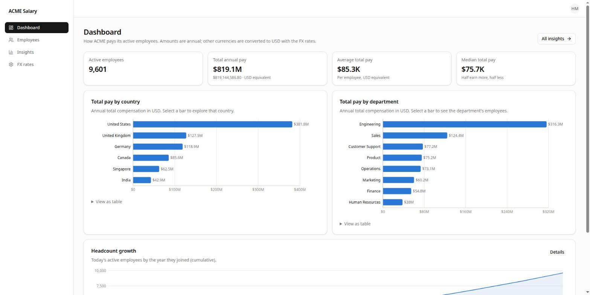
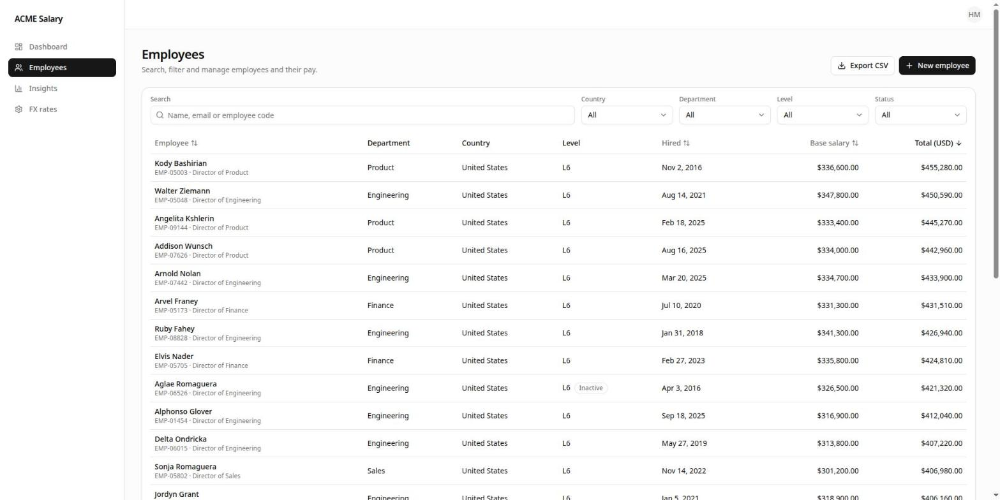
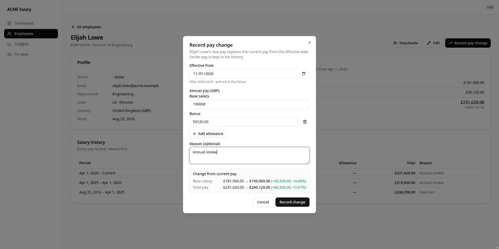
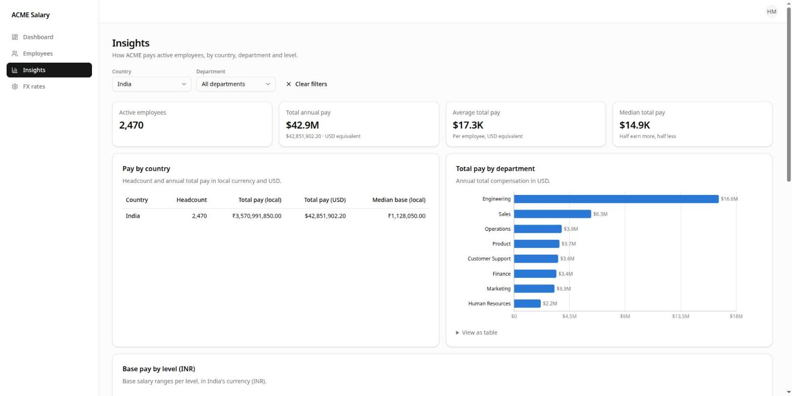
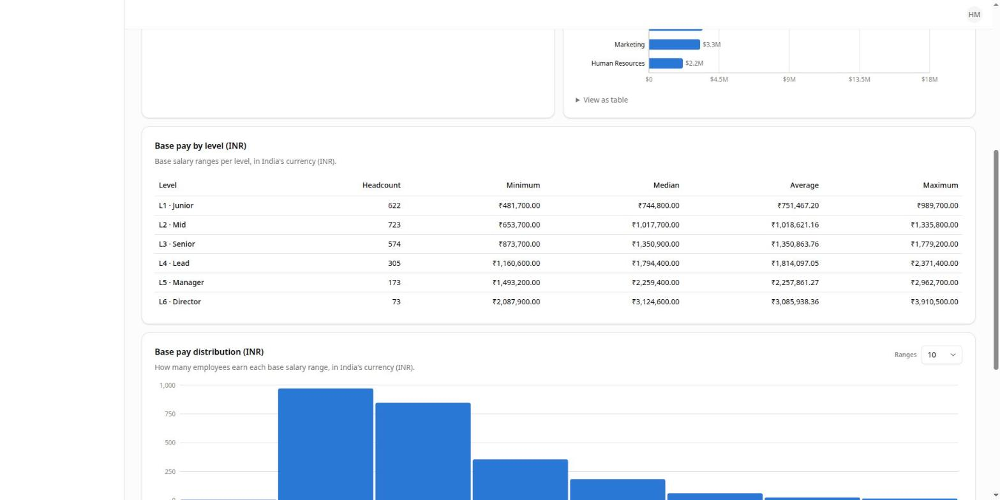

# ACME Salary Management

[](https://github.com/Chaitanya0076/employee-salary-management/actions/workflows/ci.yml)

A web app for ACME's **HR Manager** to manage salary data for about **10,000 employees across six countries**, replacing spreadsheets, and to answer questions about how the company pays people.

**Live demo:** https://employee-salary-management-lovat.vercel.app
Demo credentials are shared privately with reviewers (they're not in the repo). The API runs on Render's free tier, so the first request after a quiet spell can take about a minute while it wakes up.



## Contents
[Features](#features) · [Quick start](#quick-start) · [Architecture](#architecture) · [Key decisions](#key-decisions-and-trade-offs) · [Testing](#testing) · [Performance](#performance) · [Security](#security) · [How AI was used](#how-ai-was-used) · [Docs](#documentation)

## Features

Mapped to the [requirements](docs/requirements.md). All five success criteria are met in the deployed app.

| Requirement | What's built |
|---|---|
| **Find and filter employees** | Server-side search (name, email, code), filters (country, department, level, status), sorting and pagination over 10k records. The whole view lives in the URL, so it can be shared and survives reloads. |
| **See current pay and history** | Employee page with pay broken down into base, bonus and allowance, a USD equivalent, and the full salary history newest first. |
| **Record pay changes safely** | Effective-dated changes that never overwrite history. A live preview shows the change in amount and percent. On the server it's one transaction with a row lock; invalid or concurrent changes are rejected with clear messages. |
| **Pay insights** | Dashboard and Insights: totals, averages and medians in USD; breakdowns by country (local currency and USD), department and level; pay distribution; headcount trend. Local currency within one country, USD across countries. Every chart has a table view. |
| **Export** | CSV of exactly the current filtered view (formula-injection safe, opens correctly in Excel). |
| **Manage reference data** | Static FX-to-USD rates that HR can edit; every USD figure updates immediately. Create, edit and deactivate employees. |

| Employees | Pay change |
|---|---|
|  |  |

| Insights (India) | Levels and distribution in local currency |
|---|---|
|  |  |

## Quick start

Prerequisites: **Node.js 24** (`nvm use` reads `.nvmrc` in each app) and **Docker**.

```bash
# 1. PostgreSQL
docker compose up -d

# 2. API (terminal 1)
cd backend
npm install               # also generates the Prisma client
cp .env.example .env      # local-only defaults, including the demo HR login
npm run db:migrate
npm run db:seed           # 10,000 deterministic employees, about 20 s
npm run dev               # http://localhost:4000/api/health

# 3. Web app (terminal 2)
cd frontend
npm install
npm run dev               # http://localhost:5173, sign in with SEED_HR_EMAIL / SEED_HR_PASSWORD from backend/.env
```

The Vite dev server proxies `/api` to the API, so the browser talks to one origin, just as in production.

### Tests

```bash
cd backend && npm test            # unit + API + integration (needs Docker Postgres running)
cd backend && npm run test:unit   # no database needed
cd frontend && npm test
```

<details>
<summary>All scripts</summary>

**Backend**

| Script | What it does |
|---|---|
| `npm run dev` | API with reload on change |
| `npm run build` / `npm start` | Compile to `dist/` and run it |
| `npm test` | All tests (needs Postgres) |
| `npm run test:unit` / `npm run test:integration` | Without a database / against an auto-created `salary_management_test` database |
| `npm run lint` / `npm run typecheck` / `npm run format` | ESLint / TypeScript / Prettier |
| `npm run db:migrate` / `npm run db:deploy` | Apply migrations (development / CI and production) |
| `npm run db:seed` / `npm run db:reset` | Reload demo data / drop, migrate and reload |
| `npm run bench` | Latency benchmark against a running server ([performance](docs/performance.md)) |
| `bash scripts/seed-production.sh` | Guided one-off production seed ([deployment](docs/deployment.md)) |

**Frontend**

| Script | What it does |
|---|---|
| `npm run dev` | Vite dev server with the `/api` proxy |
| `npm run build` / `npm run preview` | Type-check and build / serve the build |
| `npm test` | Vitest + React Testing Library |
| `npm run lint` / `npm run typecheck` / `npm run format` | ESLint / TypeScript / Prettier |

</details>

## Architecture

```
Browser ──► Vercel (React SPA) ──/api rewrite──► Render (Express API) ──► PostgreSQL 16
```

- **Frontend** (`frontend/`): React 19 + TypeScript + Vite, shadcn/ui + Tailwind, TanStack Query, Recharts. Routes are code-split.
- **Backend** (`backend/`): Express 5 + TypeScript, organised by domain module (`auth`, `employees`, `compensation`, `analytics`, `reference`), each split into routes → controller → service → repository. Zod validates every request, and one error handler gives every error the same shape.
- **Data:** PostgreSQL via Prisma. Money is stored as exact decimals with a currency code, and all aggregations run in SQL.
- **Same origin:** the browser only talks to the Vercel domain, which forwards `/api` to Render. The session cookie is first-party and no CORS is needed.

More detail: [architecture](docs/architecture.md) · [data model](docs/data-model.md) · [decision records](docs/adr/) · [deployment](docs/deployment.md).

## Key decisions and trade-offs

| Decision | Why | Trade-off |
|---|---|---|
| **Express over NestJS** | A small app; explicit structure by convention is easier to read than decorators and a DI container | The structure isn't enforced by the framework; it's documented and kept consistent |
| **PostgreSQL over SQLite** | Medians, histograms, partial unique indexes, row locks; durable storage when deployed | Local dev needs Docker |
| **Effective-dated pay records with components** | History is kept, never overwritten; breakdown by base, bonus and allowance | Current pay needs a join (kept fast by a partial index) |
| **Static FX table, editable by HR** | Org-wide totals in USD, reproducible numbers, no external API | Rates can go stale; there's no rate history |
| **No cache (yet)** | Fast enough locally; caching was measured before being added | Slow on the free hosting tier; the fix is recorded ([ADR-0006](docs/adr/0006-redis-optional.md)) |
| **Same-origin `/api` through Vercel** | First-party `SameSite=Lax` cookie, no CORS | The API URL is still publicly reachable (see Security) |
| **One repo, two independent apps** | One link and one history for reviewers; each app deploys on its own | A little duplication (API types on both sides) |
| **Deliberately out of scope** | Payroll, tax, live FX, roles and SSO, bulk import, approvals ([reasons](docs/requirements.md#3-out-of-scope-and-why)) | Documented as future work |

## Testing

**386 automated tests**, all deterministic (fixed seed data, no network calls, an injected clock), run in CI on every push and pull request.

| Suite | Count | Covers |
|---|---:|---|
| Backend unit | 179 | Business rules with fake repositories: pay-change rules, auth and tokens, money and FX maths, SQL builders, CSV escaping, histogram buckets, config |
| Backend API (no DB) | 18 | The real Express app with fake services: auth flow, cookie flags, rate limiting behind proxies, error shapes |
| Backend integration | 82 | The real services against PostgreSQL with hand-written fixtures: filters, sorting, export, pay changes incl. a concurrent double-submit, insights with hand-computed values |
| Frontend | 107 | The real routes with a mocked API: login and redirects, URL state, forms and server errors, pay-change dialog, dashboard, insights, FX editing |

## Performance

Measured, not assumed ([performance.md](docs/performance.md)). Locally on the 10k dataset, every list and insight endpoint meets **p95 < 300 ms**, after three query fixes found by benchmarking:
- pay sorts: 694 → 114 ms
- deep pages: up to 478 → 54 ms
- full export: 2.9 s → 0.53 s

On Render's free tier the insight endpoints take about 2 s (a fraction of one CPU). That's recorded with the decision to fix the hardware before adding a cache.

## Security

All data sits behind a signed session cookie (`HttpOnly`, `Secure`, `SameSite=Lax`).
- Passwords use bcrypt (cost 12), and failures give the same message and timing whether the email exists or not.
- Inputs are validated by strict schemas and SQL values are always parameterised.
- The frontend has a strict Content-Security-Policy, and there are no secrets in the repo.
- There's a per-IP login rate limit, with the client IP resolved through the proxy chain measured on the live deploy.

**Known, accepted risk:** calling the public Render URL directly can fake the client IP and get around the per-IP login limit. Brute force stays impractical (bcrypt, strong password). The next step is a per-account failed-login limit, which has a lockout trade-off. That, plus Vercel-only access, MFA and a WAF, is written up in [architecture.md §10](docs/architecture.md#10-security).

## How AI was used

The brief asked for intentional use of AI. This is how it was used, and where human judgement stayed in charge.

**Workflow.** Planning started in a ChatGPT conversation about stack, scope and the salary model ([`prompts/prompt-00.md`](prompts/prompt-00.md)). The build then ran in Claude Code as 12 steps, each driven by a prompt in [`prompts/`](prompts/). Each prompt was drafted with the AI, then edited and finalised by me before anything ran. Every step's diff was reviewed and committed by hand, which is why the git history reads one step at a time.

**What came from where.**
- **My decisions:** scope and trade-offs, e.g.
  - a static FX table rather than per-currency reporting only
  - CSV export but no import
  - pay as components with history
  - Redis optional
  - one repo with two apps instead of a monorepo
  - Node 24 instead of 20
  - deferring the per-account login limit

  Also: creating the accounts, deploying, seeding production, and choosing credentials.
- **Generated by the AI, reviewed by me:** most code, tests and first drafts of the docs.

**Verification over trust.** Many problems were found by measuring and running things rather than by reading the AI's output:
- **Benchmarks, not intuition, drove query design.** The first employee-list query missed the latency target on pay sorts (694 ms p95) and export (2.9 s); query plans and re-measurement got them to 114 ms and 0.53 s.
- **A CI dry run** (only committed files, fresh installs, every workflow step) caught an unformatted config file that would have failed CI on its first run.
- **A local production rehearsal** (built frontend with production headers, API in production mode behind a stand-in proxy) caught a start script that didn't load env vars, and confirmed the CSP didn't break any page.
- **`TRUST_PROXY` was measured on the live deploy.** The AI's documented guess (2) was wrong; the real proxy chain gave 4. With 2, all users would have shared one login rate limit.
- **Tool output was checked, not accepted.** The shadcn CLI silently replaced a two-line helper with a brand-new pre-1.0 npm package; this was reverted each time. npm's `latest` tags pointed at a Prisma release candidate and TypeScript 7; stable versions were pinned on purpose.
- **Checking in the browser found bugs the tests couldn't:** a misleading pay-change toast ("£8,500" instead of "+£8,500"), a table widening the mobile layout, a histogram whose bars read as separate categories, and chart titles that weren't real headings.
- **Flaky tests were root-caused, not retried:** the failing run was captured and the cause found (lazy-loaded pages exceeding a 1 s wait) before changing anything.

**Limits, and how they were handled.**
- The AI didn't handle production credentials. Account setup, seeding and credentials were done by hand, helped by a guided script that keeps secrets out of shell history.
- The AI's knowledge of fast-moving tools can be stale (Node 20 end-of-life, Prisma 7 configuration changes, current Actions versions, platform proxy behaviour). These were checked against current docs, release data, or the running system.
- Some AI-written expectations were wrong (a few test assertions, a first guess at a query plan). The tests and benchmarks caught them, which is why both ran at every step.

## Documentation

| Doc | Contents |
|---|---|
| [requirements.md](docs/requirements.md) | One-page requirements, out-of-scope reasons, and what changed during the build |
| [architecture.md](docs/architecture.md) | System, repo layout, request flow, API reference, testing, security |
| [data-model.md](docs/data-model.md) | Tables, business rules R1–R9, indexes |
| [adr/](docs/adr/) | Six decision records (database, frontend, backend structure, salary model, FX, caching) |
| [performance.md](docs/performance.md) | Benchmarks, query tuning, production numbers, caching decision |
| [deployment.md](docs/deployment.md) | Render and Vercel setup, seeding, proxy calibration, smoke test, rollback |
| [prompts/](prompts/) | The prompt used for each build step |
