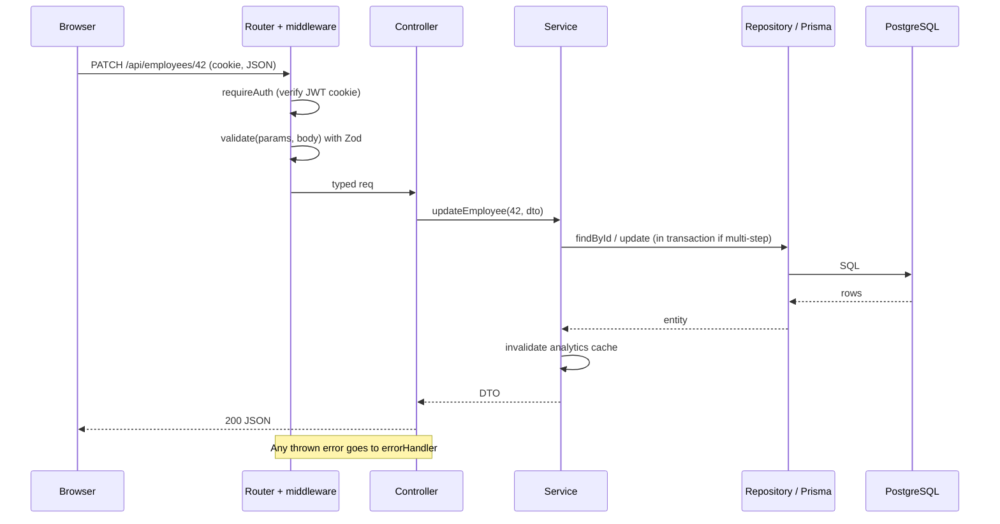

# Architecture

Derived from [requirements.md](requirements.md). The data model is in [data-model.md](data-model.md), and decisions are recorded in [adr/](adr/).

## 1. System overview


- **The frontend** is a static SPA. It holds no secrets and talks to the API only over HTTP.
- **The backend** is a stateless Express app. All business rules and validation live here.
- **PostgreSQL** is the single source of truth. Aggregations run in SQL, not in Node.
- **The cache** is an interface. The default is in-memory/no-op, and Redis is used only when `REDIS_URL` is configured (see [ADR-0006](adr/0006-redis-optional.md)).

In production, the frontend proxies `/api/*` to the backend through a Vercel rewrite. Browser and API then share one origin, so the auth cookie stays first-party (`SameSite=Lax`) and CORS isn't needed.

## 2. Repository layout

One Git repo, two independent apps (each with its own `package.json`, no workspace tooling):

```
employee-salary-management/
├── backend/
│   ├── prisma/                 schema.prisma, migrations/, seed.ts
│   ├── src/
│   │   ├── app.ts              express app (middleware + routes), no listen()
│   │   ├── server.ts           listen()
│   │   ├── config/             env parsing (Zod)
│   │   ├── shared/
│   │   │   ├── db/             Prisma client
│   │   │   ├── cache/          Cache interface, memory + redis adapters
│   │   │   ├── errors/         AppError subclasses
│   │   │   ├── middleware/     auth, validate, errorHandler, notFound
│   │   │   └── utils/          pagination, money, csv
│   │   └── modules/
│   │       ├── auth/
│   │       ├── employees/
│   │       ├── compensation/
│   │       ├── analytics/
│   │       └── reference/      countries, departments, fx-rates
│   └── tests/                  unit/ and api/
├── frontend/
│   └── src/  api/  components/  features/{employees,compensation,insights,auth}/  pages/  lib/
├── docs/                       requirements, architecture, data model, ADRs, performance
├── prompts/                    prompt-NN.md used to build each step
├── docker-compose.yml          Postgres (+ optional Redis) for local dev
└── README.md
```

### Backend module structure
Each module is a folder of layers. A layer exists only when it does real work (for example, `reference` doesn't need a service).

```
modules/employees/
├── employee.routes.ts       wires paths → middleware → controller
├── employee.controller.ts   HTTP only: read req, call service, send res
├── employee.service.ts      business rules, transactions, cache invalidation
├── employee.repository.ts   Prisma queries only
├── employee.schema.ts       Zod schemas for body/query/params (+ inferred types)
└── employee.types.ts        DTOs returned to the client
```

Dependency direction: `routes → controller → service → repository → Prisma`. Services get their repositories by plain constructor/factory injection, so unit tests can pass in fakes without a database.

## 3. Request flow



## 4. Validation and error handling
- **Validation at the edge:** `validate({ params, query, body })` middleware parses requests with Zod schemas. Controllers receive already-typed, coerced data.
- **Business rules in services:** for example "no overlapping compensation periods" or "currency must match country". Services throw typed errors.
- **Errors:** an `AppError` base class with subclasses `ValidationError` (400), `UnauthorizedError` (401), `NotFoundError` (404) and `ConflictError` (409). Known Prisma errors are mapped (unique violation → 409, record not found → 404).
- **One central `errorHandler`** returns one shape:
  ```json
  { "error": { "code": "VALIDATION_ERROR", "message": "Base component is required", "details": [ ... ] } }
  ```
  Unknown errors are logged and returned as a generic 500. Stack traces are never sent to the client.

## 5. Authentication
- A single seeded **HR Manager** user. Passwords are hashed with **bcrypt**.
- `POST /api/auth/login` checks credentials and sets a **JWT** (HS256, `JWT_SECRET`, 8h expiry) in an `httpOnly`, `Secure` (in production), `SameSite=Lax` cookie. The token is never readable by JS.
- `requireAuth` middleware protects everything except `/api/health` and `/api/auth/login`.
- Hardening, all cheap: `helmet`, rate-limited login, a JSON-only body parser with a size limit, and the same generic message for wrong email or password.
- No RBAC: there is one role (`HR_MANAGER`), stored on the user so it can be extended later.

## 6. API endpoints
All endpoints are under `/api`, return JSON unless noted, and require auth unless marked public.

**List conventions:** `page` (default 1), `pageSize` (default 25, max 100), `sort=field:asc|desc`. The response is `{ data: [...], meta: { page, pageSize, total, totalPages } }`.

| Method | Path | Purpose | Query / body |
|---|---|---|---|
| GET | `/health` | Liveness + DB check (public) | – |
| POST | `/auth/login` | Log in, set cookie (public) | `{ email, password }` |
| POST | `/auth/logout` | Clear cookie | – |
| GET | `/auth/me` | Current user | – |
| GET | `/employees` | Paginated list with current pay summary | `page, pageSize, sort` (`name`, `employeeCode`, `hireDate`, `baseSalary`, `totalUsd`), `q` (name/code/email), `country`, `department`, `level`, `status` |
| GET | `/employees/export` | CSV of the filtered list (`text/csv`, streamed) | same filters as the list, no pagination |
| GET | `/employees/:id` | Employee details + current compensation | – |
| POST | `/employees` | Create an employee **with** initial compensation (one transaction) | employee fields + `compensation { effectiveFrom, components[] }` |
| PATCH | `/employees/:id` | Update employee fields, including `status` (deactivate/reactivate) | partial employee fields |
| GET | `/employees/:id/compensation` | Current record + full history (newest first) | – |
| POST | `/employees/:id/compensation` | Record a pay change (closes current, opens new) | `{ effectiveFrom, components: [{ type, amount }], reason? }` |
| GET | `/analytics/summary` | Headcount, total annual spend (USD), avg total pay (USD) | `country?`, `department?` |
| GET | `/analytics/by-country` | Per country: headcount, total spend (local + USD), avg/median/min/max base | `department?` |
| GET | `/analytics/by-department` | Per department: headcount, total spend USD, avg/median base USD | `country?` |
| GET | `/analytics/by-level` | Per level: avg/median/min/max base (local currency when `country` is given, otherwise USD) | `country?`, `department?` |
| GET | `/analytics/distribution` | Base-pay histogram buckets | `country?`, `level?`, `buckets` (default 10) |
| GET | `/analytics/headcount-trend` | Hires per year and cumulative headcount | `country?`, `department?` |
| GET | `/countries` | Countries with currency | – |
| GET | `/departments` | Departments | – |
| GET | `/fx-rates` | Static FX-to-USD rates | – |
| PUT | `/fx-rates/:currency` | Update one rate (invalidates analytics cache) | `{ rateToUsd }` |

Analytics only count **ACTIVE** employees and their **current** compensation.

## 7. Caching (optional, added last)
- The interface is `Cache { get, set(key, value, ttl), invalidate(namespace) }`, with `MemoryCache`/`NoopCache` as the default and `RedisCache` used when `REDIS_URL` is set.
- Only `analytics/*` responses are cached. The key is namespace + version + normalised query, and TTL is 10 minutes.
- Writes to employees, compensation or FX rates bump the `analytics` namespace version, which invalidates every analytics entry in one step.
- It only gets switched on after [performance.md](performance.md) shows a measured need (see [ADR-0006](adr/0006-redis-optional.md)).

## 8. Testing approach
- **Unit (Vitest):** services with fake repositories. Covers compensation rules, pagination/sort parsing, money and FX conversion, CSV formatting, and cache invalidation.
- **API (Supertest):** `app.ts` against a disposable Postgres test database (docker). Covers auth guard, validation errors, list filters, and the pay-change happy and failure paths.
- **Frontend (Vitest + React Testing Library):** key components such as the filters, the pay-change form validation, and the history table.
- Everything is deterministic: fixed seed data, no network calls, and an injected clock for "today".

## 9. Configuration
Env vars are validated at startup with Zod, so the app fails fast on bad config:
- backend: `DATABASE_URL`, `JWT_SECRET`, `PORT`, `NODE_ENV`, `CORS_ORIGIN` (local dev only), `REDIS_URL?`
- frontend: `VITE_API_BASE_URL` (defaults to `/api`)
