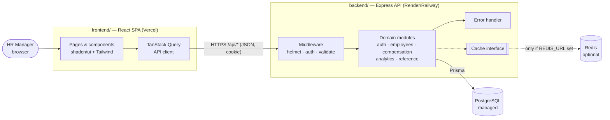
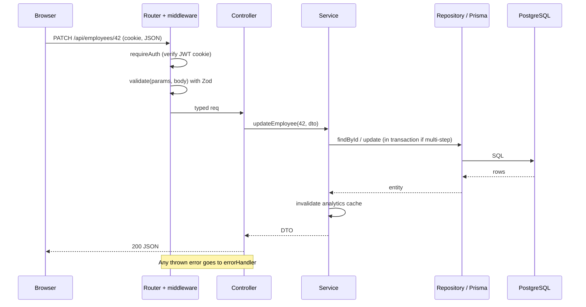

# Architecture

Derived from [requirements.md](requirements.md). The data model is in [data-model.md](data-model.md), and decisions are recorded in [adr/](adr/).

## 1. System overview



- **The frontend** is a static SPA. It holds no secrets and talks to the API only over HTTP.
- **The backend** is a stateless Express app. All business rules and validation live here.
- **PostgreSQL** is the single source of truth. Aggregations run in SQL, not in Node.
- **The cache** is an interface. The default is in-memory/no-op, and Redis is used only when `REDIS_URL` is configured (see [ADR-0006](adr/0006-redis-optional.md)).

In production, the frontend proxies `/api/*` to the backend through a Vercel rewrite. Browser and API then share one origin, so the auth cookie stays first-party (`SameSite=Lax`) and CORS isn't needed.

## 2. Repository layout

One Git repo, two independent apps (each with its own `package.json`, no workspace tooling):

```
employee-salary-management/
├── backend/
│   ├── prisma/                 schema.prisma, migrations/, seed.ts
│   ├── src/
│   │   ├── app.ts              express app (middleware + routes), no listen()
│   │   ├── server.ts           listen()
│   │   ├── config/             env parsing (Zod)
│   │   ├── shared/
│   │   │   ├── db/             Prisma client
│   │   │   ├── cache/          Cache interface, memory + redis adapters
│   │   │   ├── errors/         AppError subclasses
│   │   │   ├── middleware/     auth, validate, errorHandler, notFound
│   │   │   └── utils/          pagination, money, csv
│   │   └── modules/
│   │       ├── auth/
│   │       ├── employees/
│   │       ├── compensation/
│   │       ├── analytics/
│   │       └── reference/      countries, departments, fx-rates
│   └── tests/                  unit/ and api/
├── frontend/
│   └── src/  api/  components/  features/{employees,compensation,insights,auth}/  pages/  lib/
├── docs/                       requirements, architecture, data model, ADRs, performance
├── prompts/                    prompt-NN.md used to build each step
├── docker-compose.yml          Postgres (+ optional Redis) for local dev
└── README.md
```

### Backend module structure
Each module is a folder of layers. A layer exists only when it does real work (for example, `reference` doesn't need a service).

```
modules/employees/
├── employee.routes.ts       wires paths → middleware → controller
├── employee.controller.ts   HTTP only: read req, call service, send res
├── employee.service.ts      business rules, transactions, cache invalidation
├── employee.repository.ts   Prisma queries only
├── employee.schema.ts       Zod schemas for body/query/params (+ inferred types)
└── employee.types.ts        DTOs returned to the client
```

Dependency direction: `routes → controller → service → repository → Prisma`. Services get their repositories by plain constructor/factory injection, so unit tests can pass in fakes without a database.

## 3. Request flow



## 4. Validation and error handling
- **Validation at the edge:** `validate({ params, query, body })` middleware parses requests with Zod schemas. Controllers receive already-typed, coerced data.
- **Business rules in services:** for example "no overlapping compensation periods" or "currency must match country". Services throw typed errors.
- **Errors:** an `AppError` base class with subclasses `ValidationError` (400), `UnauthorizedError` (401), `NotFoundError` (404) and `ConflictError` (409). Known Prisma errors are mapped (unique violation → 409, record not found → 404).
- **One central `errorHandler`** returns one shape:
  ```json
  { "error": { "code": "VALIDATION_ERROR", "message": "Base component is required", "details": [ ... ] } }
  ```
  Unknown errors are logged and returned as a generic 500. Stack traces are never sent to the client.

## 5. Authentication
- A single seeded **HR Manager** user. Passwords are hashed with **bcrypt**.
- `POST /api/auth/login` checks credentials and sets a **JWT** (HS256, `JWT_SECRET`, 8h expiry) in an `httpOnly`, `Secure` (in production), `SameSite=Lax` cookie. The token is never readable by JS.
- **Protected by default:** public routes (`/api/health`, `/api/auth/login`, `/api/auth/logout`) are mounted first, then the `requireAuth` guard, then every other router. New modules are protected automatically. Unauthenticated requests to unknown routes get 401 rather than 404, so the route list isn't revealed.
- Logout only clears the cookie, so it stays public: a user whose session has already expired can still log out cleanly.
- Hardening, all cheap: `helmet`; login rate limit (10 **failed** attempts per IP per 15 min, so successful logins don't count); a JSON-only body parser with a size limit; the same generic message **and timing** for wrong email or wrong password (an unknown email is still compared against a dummy bcrypt hash); the user is re-read on every request so a deleted account loses access immediately.
- The rate limiter keeps its counts in memory (per instance). That's fine for one instance; a shared store (e.g. Redis) would be needed when scaling out.
- No RBAC: there is one role (`HR_MANAGER`), stored on the user so it can be extended later.

## 6. API endpoints
All endpoints are under `/api`, return JSON unless noted, and require auth unless marked public.

**List conventions:** `page` (default 1), `pageSize` (default 25, max 100), `sort=field:asc|desc`. The response is `{ data: [...], meta: { page, pageSize, total, totalPages } }`. Unknown query parameters are rejected (400), so a typo never silently returns everything. Reference lists return `{ data: [...] }`.

**Money in JSON** is always an exact decimal string with 2 places (`"120000.00"`); FX rates have 8 places. Dates are `YYYY-MM-DD`.

| Method | Path | Purpose | Query / body |
|---|---|---|---|
| GET | `/health` | Liveness + DB check (public) | – |
| POST | `/auth/login` | Log in, set cookie (public) | `{ email, password }` |
| POST | `/auth/logout` | Clear cookie (public) | – |
| GET | `/auth/me` | Current user | – |
| GET | `/employees` | Paginated list; each row has `pay { currency, base, total, baseUsd, totalUsd }` | `page, pageSize, sort` (`name`, `employeeCode`, `hireDate`, `baseSalary`, `totalUsd`), `q` (substring of name/email/code), `country`, `department`, `level`, `status` |
| GET | `/employees/export` | CSV of the filtered list (`text/csv`, UTF-8 BOM for Excel, formula-injection safe, streamed in chunks) | same filters and sort as the list, no pagination |
| GET | `/employees/:id` | Employee details + current compensation | – |
| POST | `/employees` | Create an employee **with** initial compensation (one transaction). Code (`EMP-#####`) and currency are derived; pay starts on the hire date | employee fields + `compensation { components[] }` |
| PATCH | `/employees/:id` | Update employee fields, including `status` (deactivate/reactivate). Country can't change (pay history is in its currency) | partial employee fields |
| GET | `/employees/:id/compensation` | `{ employeeId, currency, current, history }`: `history` is every record newest first (current included), each with components, totals and USD equivalents (at today's FX rate) | – |
| POST | `/employees/:id/compensation` | Record a pay change: in one transaction, lock the current record, close it at `effectiveFrom`, open the new one. Returns `{ compensation, previous, change: { base, total } }` (absolute and % change). 400 for a bad date or identical pay; 409 for an inactive employee or a concurrent change | `{ effectiveFrom, components: [{ type, amount }], reason? }` |
| GET | `/analytics/summary` | `{ headcount, currency: "USD", totalPay, averagePay, medianPay }` (total compensation) | `country?`, `department?` |
| GET | `/analytics/by-country` | `{ data }` per country, largest USD spend first: headcount, `totalPay` (local) + `totalPayUsd`, base `{ average, median, min, max }` in local currency | `department?` |
| GET | `/analytics/by-department` | `{ currency: "USD", data }` per department: headcount, `totalPayUsd`, base `{ average, median }` in USD | `country?` |
| GET | `/analytics/by-level` | `{ currency, data }` per level: headcount, base stats (local currency when `country` is given, otherwise USD) | `country?`, `department?` |
| GET | `/analytics/distribution` | `{ currency, data: [{ from, to, count }] }`: base-pay histogram with readable edges (steps of 1/2/2.5/5 × 10ⁿ), at most `buckets` buckets; last bucket includes its upper edge | `country?`, `department?`, `level?`, `buckets` (2–50, default 10) |
| GET | `/analytics/headcount-trend` | `{ data: [{ year, hires, cumulative }] }`: hires per year of today's active employees (years without hires included). There's no termination date in the model, so this shows how the current workforce was built up, not historical headcount | `country?`, `department?` |
| GET | `/countries` | Countries with currency | – |
| GET | `/departments` | Departments | – |
| GET | `/fx-rates` | Static FX-to-USD rates | – |
| PUT | `/fx-rates/:currency` | Update one rate (USD is fixed at 1; invalidates analytics cache once caching exists) | `{ rateToUsd }` |

Insight endpoints reject unknown country/department values with 400 rather than returning empty results. Medians use `percentile_cont(0.5)` (the two middle values are averaged for even counts).

Sorting by `baseSalary` or `totalUsd` uses the **USD equivalent**, so the order is meaningful across currencies. Within one country it matches the local-amount order.

Analytics only count **ACTIVE** employees and their **current** compensation.

## 7. Caching (optional, added last)
- The interface is `Cache { get, set(key, value, ttl), invalidate(namespace) }`, with `MemoryCache`/`NoopCache` as the default and `RedisCache` used when `REDIS_URL` is set.
- Only `analytics/*` responses are cached. The key is namespace + version + normalised query, and TTL is 10 minutes.
- Writes to employees, compensation or FX rates bump the `analytics` namespace version, which invalidates every analytics entry in one step.
- It only gets switched on after [performance.md](performance.md) shows a measured need (see [ADR-0006](adr/0006-redis-optional.md)).

## 8. Testing approach
- **Unit (Vitest):** services with fake repositories. Covers compensation rules, pagination/sort parsing, money and FX conversion, CSV formatting, and cache invalidation.
- **API without a database (Supertest):** `createApp()` with fake services. Covers health, auth and error handling.
- **Integration (Supertest + Postgres):** the real services from the composition root (`src/container.ts`) against a separate `salary_management_test` database. A Vitest global setup creates and migrates it, and each test reloads hand-written fixtures with known values. Covers list filters/sort/pagination, export, create/update rules, and 404/409 cases.
- **Frontend (Vitest + React Testing Library):** key components such as the filters, the pay-change form validation, and the history table.
- Everything is deterministic: fixed seed data, no network calls, and an injected clock for "today".

## 9. Configuration and operations
- Access log: one JSON line per request (method, path without the query string, status, duration, client IP), skipped in tests.
- Deployment (Render + Vercel), CI and rollback: [deployment.md](deployment.md).

Env vars are validated at startup with Zod, so the app fails fast on bad config:
- backend: `DATABASE_URL`, `JWT_SECRET` (≥ 32 chars; the example placeholder is refused in production), `JWT_TTL_MINUTES` (default 480), `TRUST_PROXY` (number of proxies in front of the API, so rate limiting sees real client IPs; `2` in production, calibrated as in [deployment.md](deployment.md)), `LOG_FORWARDED_FOR` (adds the raw `X-Forwarded-For` chain to access logs while calibrating), `PORT`, `NODE_ENV`
- No CORS configuration: `/api` is same-origin in both environments (Vite dev-server proxy locally, Vercel rewrite in production).
- frontend: `VITE_API_BASE_URL` (defaults to `/api`)
