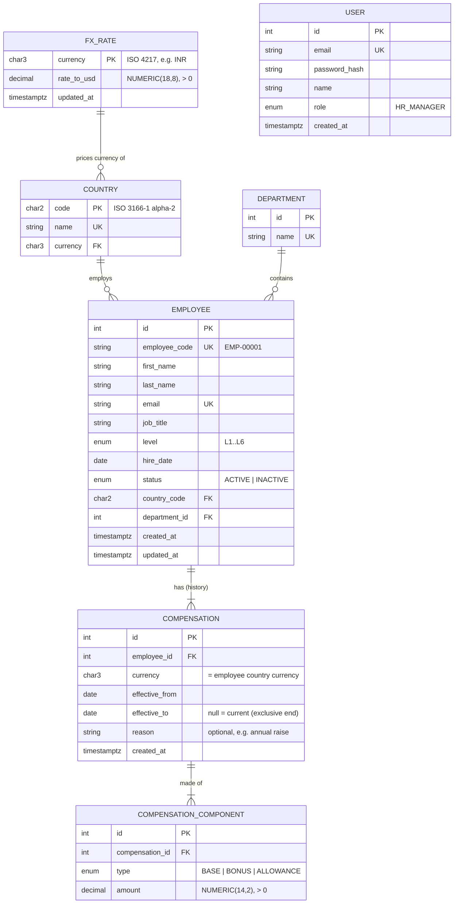

# Data Model

PostgreSQL via Prisma (tables are plural snake_case: `employees`, `compensations`, `compensation_components`, `fx_rates`, …). Money is `NUMERIC(14,2)` (Prisma `Decimal`) together with an ISO-4217 currency code. Floats are never used for money. All amounts are **annual**.

## ER diagram



`USER` has no relations. It is the HR login account, separate from `EMPLOYEE`.

## Tables

| Table | Purpose | Notes |
|---|---|---|
| **FxRate** | Static conversion rate from each currency to USD, maintained by HR. | `USD` row has rate `1`. Only used for reporting. Stored amounts are never converted. |
| **Country** | Where an employee works; fixes their pay currency. | FK to `FxRate.currency`, so every currency in use always has a rate. Seeded with about 6 countries (US, GB, IN, DE, CA, SG). |
| **Department** | Org unit (Engineering, Sales, HR, …). | About 8 seeded. |
| **Employee** | The person record. | `status = INACTIVE` is a soft delete: history stays, and analytics exclude them. `level` L1 (entry) … L6 (director). |
| **Compensation** | One pay period for an employee. | Effective-dated, append-only history. `currency` is copied from the country when the record is created, so the record stays correct even if reference data changes later. |
| **CompensationComponent** | Line items of a compensation record. | Total pay = sum of components. Base = the `BASE` row. |
| **User** | HR Manager login. | Seeded. Password hashed with bcrypt. |

## Business rules (enforced in the service layer, backed by DB constraints where cheap)

| # | Rule | Enforcement |
|---|---|---|
| R1 | A compensation has **exactly one `BASE`** component, and at most one of each other type. | Service validation + `UNIQUE (compensation_id, type)` |
| R2 | Every amount is **> 0**, with 2 decimal places. | Zod + `CHECK (amount > 0)` |
| R3 | `Compensation.currency` **equals the employee's country currency**. | Service (derived, never accepted from the client) |
| R4 | An employee's compensation periods **never overlap**. | Service, inside a transaction. A pay change must start **after** the current record's `effective_from`. The current record is closed with `effective_to = new.effective_from`. |
| R5 | **Current pay** = the record with `effective_to IS NULL`. There is **at most one** per employee. | Partial unique index `UNIQUE (employee_id) WHERE effective_to IS NULL` |
| R6 | v1 allows pay changes effective **today or earlier** (no future-dated changes), and no back-dating before the current record. | Service + injected clock. This keeps rule R5's "open-ended = current" true. Scheduled future raises are future work. |
| R7 | Every employee has a compensation from creation. | `POST /employees` creates employee + first compensation in one transaction. |
| R8 | `effective_to > effective_from` when set. | `CHECK` constraint |

Constraints Prisma can't express (partial unique index, CHECKs, trigram index) are added as raw SQL in the migration.

## Indexes (10k employees, about 20k–30k compensation rows)

| Index | Serves |
|---|---|
| `employee(employee_code)` UNIQUE, `employee(email)` UNIQUE | exact lookups, integrity |
| `employee(country_code, department_id, level)` composite | list filters and analytics group-bys (leading column = most common filter) |
| `employee(department_id)` | filter by department alone |
| `employee(status)` | active-only queries |
| `employee(last_name, first_name)` | default sort by name |
| GIN `pg_trgm` on `lower(first_name || ' ' || last_name || ' ' || email || ' ' || employee_code)` | `q` substring search (`ILIKE '%…%'`) |
| `compensation(employee_id, effective_from DESC)` | history per employee |
| partial UNIQUE `compensation(employee_id) WHERE effective_to IS NULL` | R5 + fast join to current pay |
| `compensation_component(compensation_id, type)` UNIQUE | R1 + component lookups |

At this scale even a sequential scan takes only a few ms. These indexes keep p95 latency flat as data grows, and they'll be checked with `EXPLAIN ANALYZE` in performance.md.

## How analytics read the model
```sql
-- current pay per active employee, in local currency and USD
SELECT e.id, e.country_code, e.department_id, e.level,
       SUM(cc.amount) FILTER (WHERE cc.type = 'BASE')       AS base,
       SUM(cc.amount)                                      AS total,
       SUM(cc.amount) * fx.rate_to_usd                     AS total_usd
FROM employees e
JOIN compensations c            ON c.employee_id = e.id AND c.effective_to IS NULL
JOIN compensation_components cc ON cc.compensation_id = c.id
JOIN fx_rates fx                ON fx.currency = c.currency
WHERE e.status = 'ACTIVE'
GROUP BY e.id, fx.rate_to_usd;
```
Aggregates (avg, `percentile_cont(0.5)` for median, min, max, `width_bucket` for distributions) are computed over this set. They run with Prisma `$queryRaw` (tagged templates, so parameters are bound safely).
