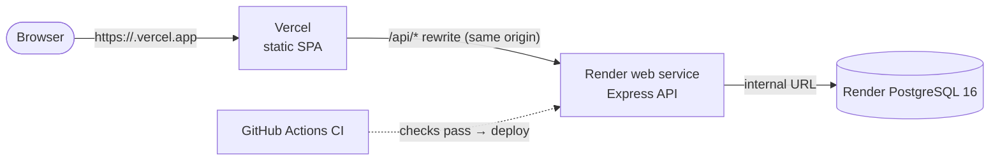

# Deployment

How to deploy ACME Salary Management. The frontend runs on **Vercel**, and the API and PostgreSQL run on **Render**. Both use free tiers.



The browser only ever talks to the Vercel domain. Vercel forwards `/api/*` to Render, so the session cookie is first-party (`SameSite=Lax`) and no CORS is needed (see [architecture.md](architecture.md) §1).

## Files involved

| File | Purpose |
|---|---|
| [`render.yaml`](../render.yaml) | Render Blueprint: the API service and the database, env vars, health check, deploy after CI passes |
| [`frontend/vercel.json`](../frontend/vercel.json) | Vercel build settings, the `/api` rewrite to Render, SPA fallback, security headers (CSP etc.) |
| [`.github/workflows/ci.yml`](../.github/workflows/ci.yml) | Lint, typecheck, tests (incl. integration tests on Postgres) and build for both apps |

## Free-tier limits worth knowing

- **Render free web services sleep after 15 minutes idle.** The first request then takes about a minute (cold start). Open the app a minute before a demo.
- **Render free PostgreSQL expires 30 days after creation** and has no backups. Upgrade the database plan, or move it to another provider, to keep it longer.
- **The free plan has no pre-deploy step**, so migrations run when the service starts (`npm run start:migrate`). `prisma migrate deploy` is idempotent, and there's one instance, so this is safe. On a paid plan, move it to `preDeployCommand`.

## 1. Deploy the API and database (Render)

1. Push the repository to GitHub (CI runs on the push).
2. On [render.com](https://render.com), sign in with GitHub and choose **New → Blueprint**.
3. Select this repository. Render reads `render.yaml` and shows the database `salary-management-db` and the service `salary-management-api`. Click **Apply**.
4. Wait for the database, then the service, to become **Live**. Render generates `JWT_SECRET`, wires `DATABASE_URL` from the database, and runs migrations on start.
5. Note the service URL, normally `https://salary-management-api.onrender.com`. If Render added a suffix because the name was taken, use that URL in step 3.
6. Check it: `https://<api-url>/api/health` should return `{"status":"ok", …, "checks":{"database":"up"}}`.

From now on, every push to `main` deploys the API **after the CI checks pass** (`autoDeployTrigger: checksPass`).

## 2. Load the demo data (one-off, from your machine)

The seed **wipes all data** and loads 10,000 deterministic employees plus the HR Manager login. Free Render instances have no shell, so run it locally against the database's **external** URL:

1. Render dashboard → `salary-management-db` → **Connect** → copy the **External Database URL**.
2. Run the seed, typing the secrets at prompts so they don't land in your shell history:

```bash
cd backend
npm ci
read -rs DATABASE_URL && export DATABASE_URL          # paste the external URL, append ?sslmode=require
read -r  SEED_HR_EMAIL && export SEED_HR_EMAIL        # e.g. hr.manager@your-company.example
read -rs SEED_HR_PASSWORD && export SEED_HR_PASSWORD  # strong, at least 12 characters
NODE_ENV=production SEED_ALLOW_PRODUCTION=true npm run db:seed
unset DATABASE_URL SEED_HR_PASSWORD
```

The seed refuses to run against production without `SEED_ALLOW_PRODUCTION=true`, and refuses the example password from `.env.example`. It takes a few minutes over the internet.

## 3. Deploy the frontend (Vercel)

1. If the Render URL differs from `https://salary-management-api.onrender.com`, update the `destination` in `frontend/vercel.json`, then commit and push.
2. On [vercel.com](https://vercel.com), sign in with GitHub, choose **Add New → Project**, and import this repository.
3. Set **Root Directory** to `frontend`. Build settings come from `vercel.json` (Vite, `npm ci`, `npm run build`, output `dist`). Set **Node.js Version** to **24.x** in the project settings if it isn't picked up from `engines`.
4. **Deploy.** Vercel redeploys on every push to `main` and creates preview deployments for pull requests.

Preview deployments use the same rewrite, so they talk to the **production** API. That's fine for this assessment; a real setup would point previews at a staging API.

## 4. Calibrate `TRUST_PROXY` (once)

The login rate limit counts attempts per client IP. Express finds the real client IP by trusting a fixed number of proxies in front of it (`TRUST_PROXY`):
- set too low, every user appears to share the proxy's IP and gets blocked together
- set too high, a client can forge its own IP

`render.yaml` defaults to `2` (Vercel's rewrite plus Render's router). Confirm it against one real request:

1. Render → `salary-management-api` → **Environment**: set `LOG_FORWARDED_FOR=true`. The service redeploys.
2. Find your public IP (e.g. search "what is my IP"), then open the Vercel app and attempt a login.
3. Render → **Logs**: find the line with `"path":"/api/auth/login"`, which has a `forwardedFor` value such as `"203.0.113.7, 76.76.21.9"`.
4. Find your IP in that list. **`TRUST_PROXY` = (number of entries to the right of your IP) + 1.** With the example above that's `1 + 1 = 2`. The line's `ip` field should equal your IP; if it doesn't, adjust and retry.
5. Set `LOG_FORWARDED_FOR=false` again.

## 5. Smoke test

Run these checks against the Vercel URL after each first deploy.

- [ ] `https://<app>/api/health` returns 200 with `"database":"up"` (this goes through the rewrite).
- [ ] A wrong password shows "Invalid email or password." The correct one opens the Dashboard.
- [ ] DevTools → Application → Cookies: `session` is `HttpOnly`, `Secure`, `SameSite=Lax`, `Path=/api`, on the Vercel domain.
- [ ] The Dashboard shows **9,601** active employees and the charts render, with no console errors (CSP).
- [ ] Employees: search, filter, sort and paging work; **Export CSV** downloads the filtered list.
- [ ] Reloading a deep link (e.g. `/employees/1`) still loads the page (SPA fallback).
- [ ] Recording a pay change on one employee updates their history and the insights.
- [ ] Changing an FX rate updates the dashboard figures. Change it back afterwards.
- [ ] After signing out, `/employees` redirects to the login page.
- [ ] The HTML response has `Content-Security-Policy`, `X-Frame-Options: DENY` and `X-Content-Type-Options: nosniff`.

## Environment variables

**API (Render)**, all validated at startup (`backend/src/config/env.ts`). The app refuses to start on bad values.

| Variable | Production value | Notes |
|---|---|---|
| `NODE_ENV` | `production` | Enables the `Secure` cookie flag; refuses the example `JWT_SECRET` |
| `DATABASE_URL` | from the Render database | Internal URL; set by the Blueprint |
| `JWT_SECRET` | generated by Render | At least 32 characters. Rotating it signs everyone out |
| `JWT_TTL_MINUTES` | `480` | Session length |
| `TRUST_PROXY` | `2` (calibrate, step 4) | Proxies in front of the app |
| `LOG_FORWARDED_FOR` | `false` | Turn on only while calibrating |
| `PORT` | set by Render | |
| `NODE_VERSION` | `24` | Render's Node version selector |

**Seed (one-off, local):** `DATABASE_URL` (external URL + `?sslmode=require`), `SEED_HR_EMAIL`, `SEED_HR_PASSWORD`, `NODE_ENV=production`, `SEED_ALLOW_PRODUCTION=true`.

**Frontend:** none needed in production. `VITE_API_BASE_URL` defaults to `/api` (see `frontend/.env.example`).

## Operations

- **Logs:** the API writes one JSON line per request (method, path without the query string, status, duration, client IP) to Render's log stream. Unexpected errors are logged with their stack. Clients only ever get a generic 500.
- **Deploys:** push to `main` → CI → Render deploys the API once the checks pass, while Vercel deploys the frontend.
- **Changing the HR password:** there's no password-change screen yet (out of scope). Re-run the seed (this resets the data) or update the bcrypt hash in the `users` table.

## Rollback

- **API:** Render → `salary-management-api` → **Events/Deploys** → choose the last good deploy → **Rollback**.
- **Frontend:** Vercel → **Deployments** → last good deployment → **Instant Rollback**.
- **Database:** migrations are forward-only, and rolling back code doesn't undo a migration. Keep migrations backward-compatible (add columns before using them, remove them only after the code stops using them), so the previous release still works against the new schema. The free database has no backups; for demo data, re-running the seed restores a known state.

## Troubleshooting

| Symptom | Likely cause |
|---|---|
| First request hangs or returns 502 | Free instance waking up; wait about a minute |
| Login succeeds but you're signed out straight away | The cookie isn't reaching the browser: check the `vercel.json` rewrite host, and that the site is served over HTTPS |
| Everyone gets "Too many login attempts" | `TRUST_PROXY` too low (all clients share the proxy IP); see step 4 |
| API exits with "Invalid environment configuration" | A missing or invalid env var; the message names it |
| Render build fails in `tsc` | The build must install dev dependencies (`npm ci --include=dev`, as in `render.yaml`) |
